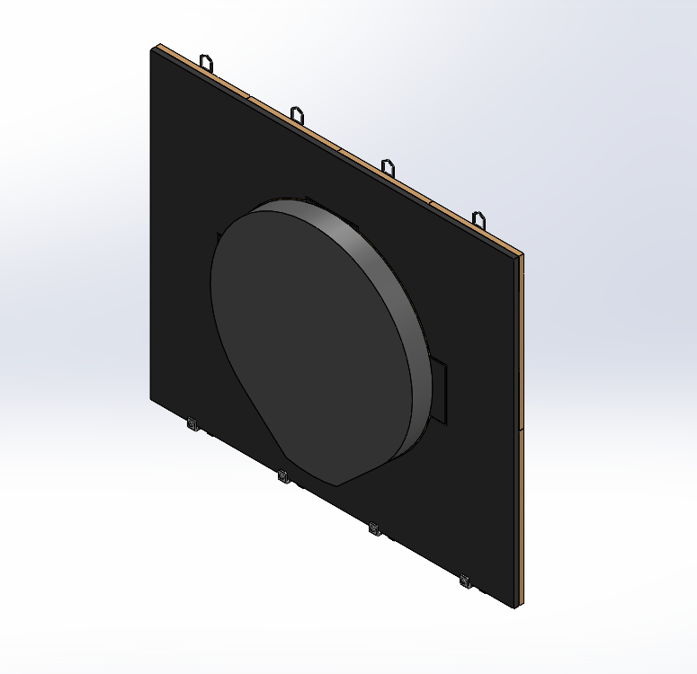
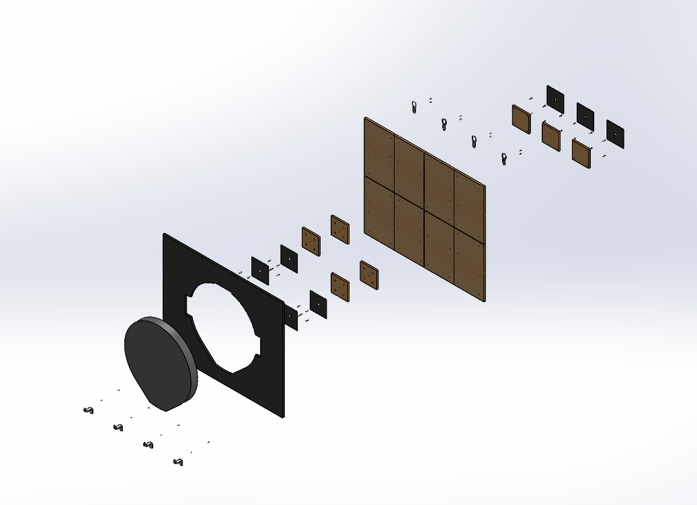

# Design Overview — Dartboard Mounting System (DMS)

**Drawing number:** DMS-ASM-001  
**Design stage:** CAD prototype — physical validation pending  
**CAD software:** SOLIDWORKS  
**Last CAD assembly mass:** 4.20205 kg (includes simplified ED110 with overridden mass)

## 1. Project Objective

Design a modular, removable mounting system for a Decathlon ED110 electronic dartboard. The system combines a wooden backboard, EVA cushioning, mechanical hanging hardware, and 3D-printed adjustable lower restraints. This repository documents the CAD concept; it does **not** certify the assembly for wall mounting.

## 2. Main Specifications

| Item | Specification |
| --- | --- |
| Overall wooden backboard | 720 × 600 × 10 mm |
| Hinoki panels | 8 pieces, each 180 × 300 × 10 mm; 4 columns × 2 rows |
| Birch plywood connector plates | 100 × 100 × 9 mm, front and rear configurations |
| ED110 dummy envelope | Approximately 400 mm wide × 460 mm high; thickness to be verified |
| Front connector EVA pads | 2 mm, 4 pieces |
| Rear connector EVA pads | 2 mm, 3 pieces |
| Front protective EVA | 10 mm, shaped to clear the ED110 outline |
| Upper hanging hardware | 4 D-ring hangers; candidate QD1637BL |
| D-ring attachment | Proposed two Ø3 × 8 mm self-tapping screws per hanger |
| Lower restraint | 3D-printed Z-shaped adjustable brackets with M3 heat-set inserts |
| Adjustment fastener | M3 × 4 mm socket-head screw, proposed |
| CAD mass | 4,202.05 g (4.202 kg rounded) |

## 3. Mechanical Architecture

### Modular wooden backboard
Eight separate Hinoki panels form the 720 × 600 mm board. Birch plywood plates join the panels while preserving distinct native SOLIDWORKS part files for assembly and BOM management. Front and rear connector plates have intentionally different screw-hole layouts to reduce the chance of fastener interference.

### Dartboard interface
A simplified ED110 solid is used to assess envelope clearance, approximate assembly mass, and mounting interfaces. Two hanging locations and two countersunk fixing locations were identified on the physical dartboard, but their final dimensions and fit require measurement against the actual product.

### Cushioning and surface protection
Four 2 mm EVA pads cushion the interface near the front mounting plates. Three 2 mm EVA pads are assigned to rear contact locations. A 10 mm EVA protective surround covers the exposed front wooden area while leaving clearance around the ED110.

### Wall mounting and adjustment
Four upper D-ring hangers are proposed as primary suspension points, with compatible wall hooks to be selected and verified. Lower Z-shaped printed brackets provide positioning and anti-sway restraint. M3 heat-set inserts and short adjustment screws allow local fit adjustment. Adhesive picture-hanging strips are proposed for auxiliary positioning, **not** as independently verified fall protection.

## 4. CAD Deliverables

- Native SOLIDWORKS parts (`.SLDPRT`), assembly (`.SLDASM`), and drawing (`.SLDDRW`).
- Exploded assembly drawing with item balloons and bill of materials (BOM).
- Neutral STEP assembly export and PDF drawing export.
- Assembly and exploded-view PNG previews.

## 5. Engineering Decisions and Limitations

- Keep all eight Hinoki panels as separate components for editability and BOM accuracy.
- Use clearance holes in birch plywood and pilot holes in Hinoki for the relevant wood-screw joints; exact pilot dimensions must be confirmed by test drilling.
- Offset front/rear fastener locations to avoid direct alignment of opposing screws.
- Use an overridden ED110 dummy mass; calculated center of mass and inertia are not independently measured physical values.
- EVA is modeled for fit and approximate mass, not as a validated structural member or guaranteed dart-penetration barrier.
- A four-point hanger arrangement does **not** guarantee equal load sharing.

## 6. Validation Required Before Installation

1. Measure actual ED110 dimensions, keyhole geometry, mounting screw engagement, and access clearances.
2. Inspect panel joints and verify screw edge distances, splitting resistance, and pull-out capacity in the actual wood.
3. Verify D-ring and wall-hook compatibility, rated use conditions, wall-paint adhesion, and possible peel loads.
4. Test repeated dart impact and dart removal forces, including the possibility of upward unhooking or outward pull.
5. Verify Z-bracket fit, heat-set insert retention, print orientation, and screw adjustment range.
6. Check EVA compression, wall clearance, and long-term movement due to wood moisture changes.
7. Use a mechanically secured or freestanding alternative if adhesive-only suspension cannot be demonstrated safe.

**Safety status:** This is a CAD prototype. The 4.202 kg assembly mass is not a proof of mounting safety; the proposed wall-mounting scheme has not been validated for dynamic loads or long-term retention.

## 7. Related Documents

- [Assembly Guide](assembly-guide.md)
- [Design Validation](design-validation.md)
- [Assembly Drawing (PDF)](../exports/drawings/DMS_Main_Assembly.pdf)
- [BOM (CSV)](../exports/BOM/DMS_BOM.csv)
